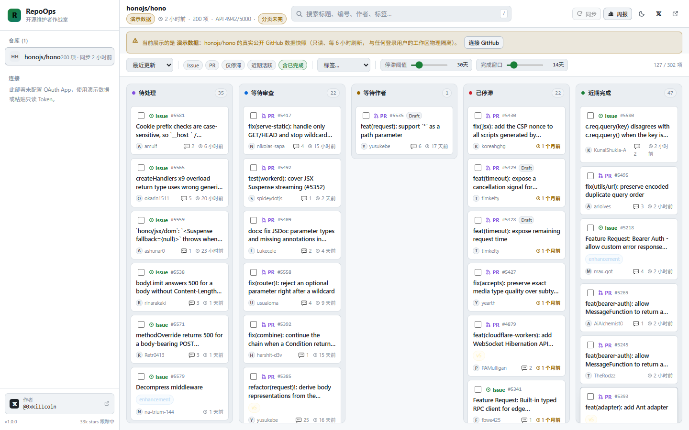
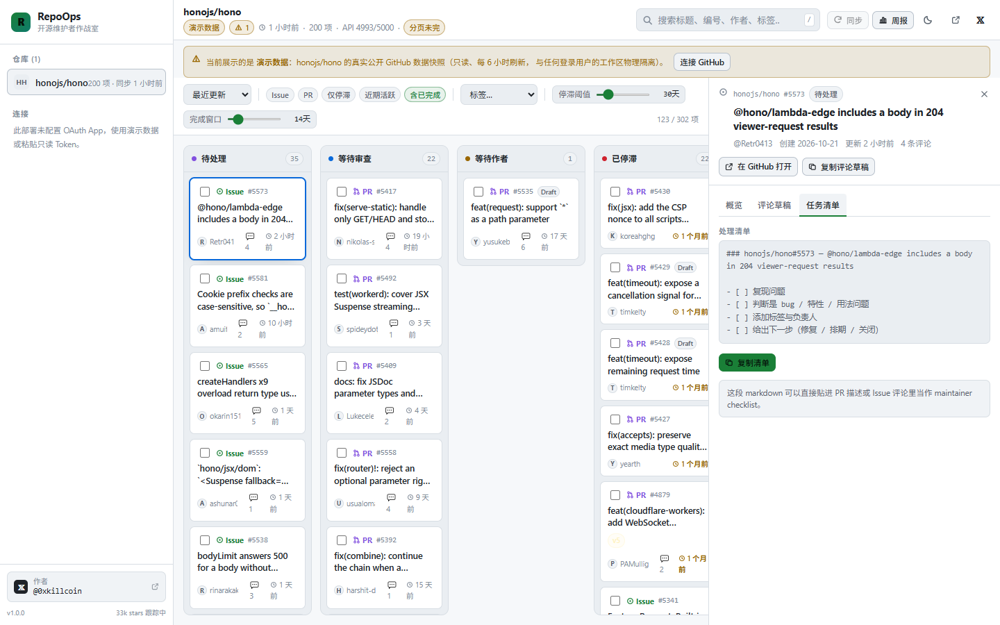
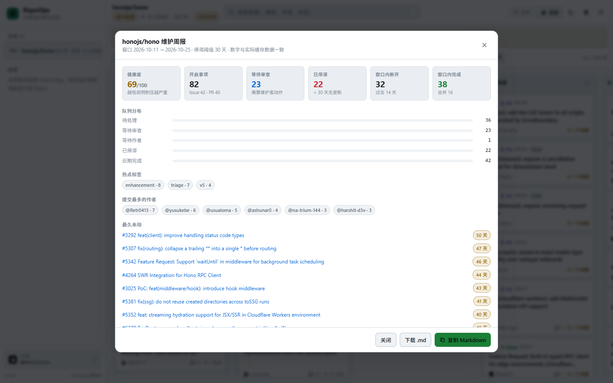
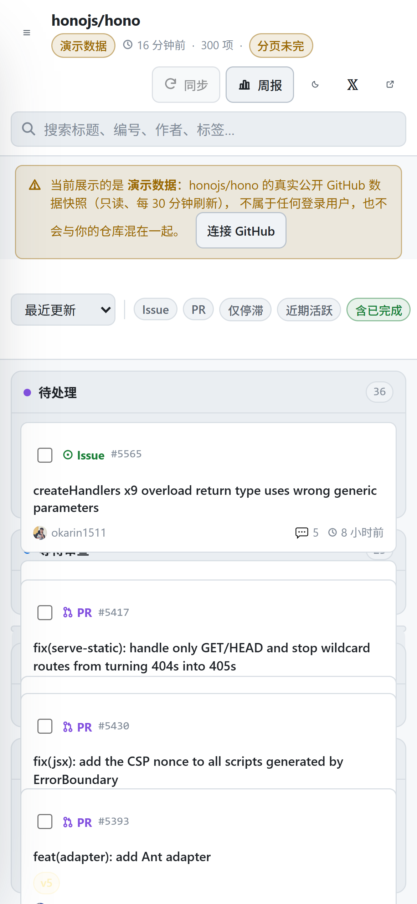
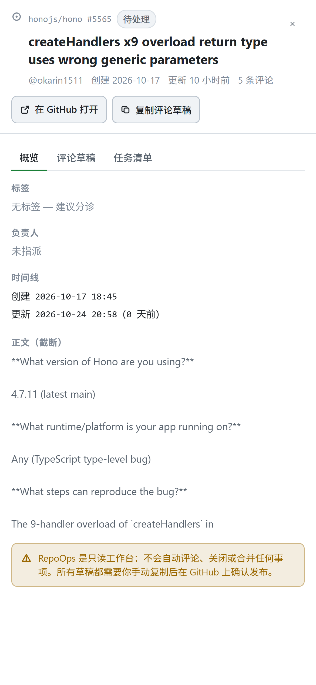
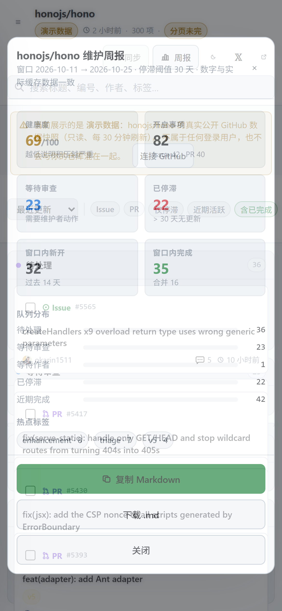
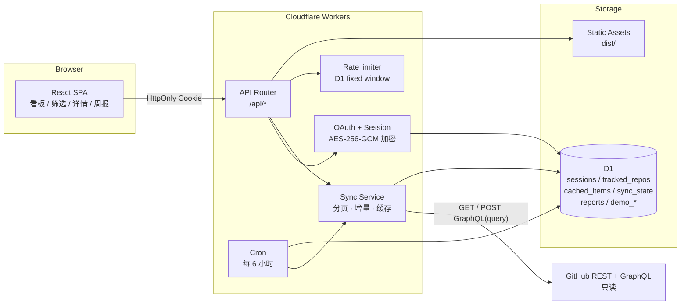

<div align="center">

# RepoOps

**开源维护者的作战室 · The war room for open-source maintainers**

把 Issues 和 PR 拆成五个真实队列，找出停滞项与审查瓶颈，一键生成可直接发布的维护周报。

[](https://repoops.852367856.dpdns.org)
[](https://www.typescriptlang.org/)
[](https://react.dev/)
[](https://workers.cloudflare.com/)
[](#-测试)
[](LICENSE)

[在线演示](https://repoops.852367856.dpdns.org) · [架构说明](docs/ARCHITECTURE.md) · [OAuth 配置](docs/OAUTH.md) · [部署指南](docs/DEPLOY.md) · [隐私政策](docs/PRIVACY.md)

作者 **𝕏 [@0xkillcoin](https://x.com/0xkillcoin)**

</div>

---

## 这是什么

开源维护者真正的时间黑洞不是写代码，而是**判断**：这 400 个 issue 里哪 20 个必须这周处理？这个 PR 是在等我 review，还是在等作者改？哪个 issue 已经烂了三个月没人管？

GitHub 的列表页能筛选、能排序，但它不回答「**我现在应该做什么**」。

RepoOps 把仓库里的事项压成五个队列：

| 队列 | 含义 | 判断规则 |
| --- | --- | --- |
| 🟣 **待处理** | 还没进入流程 | 开启的 Issue，缺少标签或缺少负责人 |
| 🔵 **等待审查** | 球在你这边 | 开启的 PR，非草稿、未被要求修改 |
| 🟡 **等待作者** | 球在对方那边 | 草稿 PR、`CHANGES_REQUESTED`、已分诊的 Issue |
| 🔴 **已停滞** | 正在腐烂 | 超过自定义阈值（默认 30 天）没有任何更新 |
| 🟢 **近期完成** | 关闭/合并 | 窗口期（默认 14 天）内关闭或合并的事项 |

停滞阈值和完成窗口都是可拖动的滑块，改动**立即**重算整个看板，不需要重新请求 GitHub。

## 功能

<table>
<tr><td width="50%" valign="top">

**工作台**

- 三栏式布局：仓库导航 / 任务看板 / 详情面板
- 顶部全局搜索（标题、编号、作者、标签、正文）
- 按标签、负责人、类型、活跃度、完成状态筛选
- 6 种排序：最近更新、最久未更新、最新/最早创建、评论最多、编号
- 可拖动停滞阈值与完成窗口
- 键盘流：`/` 搜索、`j`/`k` 切换条目、`Esc` 关闭面板

</td><td width="50%" valign="top">

**协作产物（只读，绝不自动发布）**

- 可复制的**评论草稿**：根据队列位置生成不同措辞
- 可复制的**任务清单**：maintainer checklist
- 批量选择 → 一次复制多条草稿
- **维护周报**：健康度评分、队列分布、热点标签、最久未动 Top 8、本周建议
- 周报可导出 Markdown，直接贴进 release note 或 Discussion

</td></tr>
<tr><td valign="top">

**连接与同步**

- GitHub OAuth（最小权限：`read:user public_repo`，私有仓库需显式升级）
- 只读 Token 登录作为 fallback
- 多仓库跟踪（上限 12 个）
- 增量同步：`since` 游标 + 本地 D1 缓存（打开看板 0 次 GitHub 调用）
- 分页进度、API 配额、同步错误全部可见

</td><td valign="top">

**工程细节**

- 深色 / 浅色主题，跟随系统并记忆选择
- iPhone 375px → iPad → 桌面全自适应
- 无数据、加载中、超时、限流、令牌失效、断网均有明确状态
- 演示数据与真实数据物理隔离，永远不会混在一起
- 一键断开连接并删除全部本地数据

</td></tr>
</table>

## 截图

> 以下截图全部来自真实部署（Playwright 自动截图，数据来自 `honojs/hono` 的公开 GitHub API）。

**看板（桌面端）**



**详情面板与可复制的评论草稿**



**维护周报**



**移动端（iPhone 390×844）**

<p align="center">
  
  
  
</p>

## 移动端与自适应

从 320px（iPhone SE 一代）到 1920px 桌面，布局按三段收敛：

| 宽度 | 顶栏 | 看板 | 详情 |
| --- | --- | --- | --- |
| ≤720px（手机） | 两行紧凑栅格：`☰ · 仓库名+状态 · 𝕏` / `搜索 · 同步·周报·主题·设置` | 单列纵向堆叠 | 全屏覆盖 |
| 721–1024px（平板） | 单行，状态元数据收起 | 单列纵向堆叠 | 全屏覆盖 |
| ≥1025px | 单行：仓库名 · 搜索 · 工具 · 𝕏/设置 | 五列横向看板 | 右侧 420px 面板 |

**手机顶栏优化（实测数字）**

| 设备 | 优化前 | 优化后 |
| --- | --- | --- |
| iPhone SE 320×568 | 231px（占屏 41%），6 处控件重叠 | **89px（16%），0 重叠** |
| iPhone SE2 375×667 | 195px（29%） | **89px（13%）** |
| iPhone 14 390×844 | 153px（18%） | **89px（11%）** |
| iPad mini 768×1024 | 90px，标题被状态徽标挤成 3 行 | **58px，单行** |

具体做了什么：

1. 顶栏在手机上改成 **CSS Grid 两行**，不再依赖 `flex-wrap` 自由折行——之前 5 个按钮（238px）会折到与标题重叠的第三行。
2. 次要元数据（同步时间 / 条目数 / API 配额）在手机上收起，全部仍在「设置 → 同步状态」里。
3. 多条同步警告折叠成**一个可点击的 ⚠ 药丸**（28px 触摸目标），点开就是同步详情；之前文字 chip 会被 `overflow:hidden` 从中间裁断。
4. 工具按钮在手机上只留图标（保留 `aria-label`），把宽度让给搜索框与仓库名。
5. `𝕏` 与设置固定在右上角，工具组落在第二行，两者不再争同一列。

顺带修掉的两个真实 Bug：

- **flex/grid 的 `min-width:auto` 把页面撑宽**：390px 视口下文档被一张长标题撑到 995px，导致详情面板关闭按钮跑到屏幕外点不到。
- **`100dvh` 固定壳 + 波浪式折行**：横幅和工具栏吃掉高度后，320px 屏幕上 5 列看板被压成 65px。现在 ≤1024px 整页滚动。

这些全部由 `tests/e2e/responsive-audit.mjs` 守护：11 个视口 × 159 条几何断言，任何一条退化都会让 CI 变红。

## 在线演示

**https://repoops.852367856.dpdns.org**

打开即是演示模式：加载 `honojs/hono` 的真实公开数据（300 条 Issue/PR），只读、无需登录、每 6 小时自动刷新。

- 想用自己的仓库？点右上角 ⚙ → 「连接」→ **用 GitHub 登录**（该部署已配置 OAuth App），或粘贴一个只读 PAT。
- 演示数据永远带橙色「演示数据」角标，且不会写入任何用户的工作区。
- 需要读私有仓库时用 `/api/auth/login?private=1`，scope 会从 `read:user public_repo` 提升到 `read:user repo`。

## 技术栈

| 层 | 选择 | 为什么 |
| --- | --- | --- |
| 前端 | React 19 + TypeScript 5.9 + Vite 7 | 无框架负担、构建快、类型贯通前后端 |
| 样式 | 手写 CSS + 设计变量 | 一个 19KB 的 CSS 文件搞定深色/浅色与响应式，没有 Tailwind 的构建依赖 |
| 服务端 | Cloudflare Workers（单文件路由） | 与静态资源同源部署，OAuth 回调不需要额外域名 |
| 数据库 | Cloudflare D1（SQLite） | 会话、仓库缓存、同步状态、周报快照 |
| 限流 | D1 固定窗口计数 | 与缓存同库，一次 UPSERT；不必为限流引入 Durable Object（详见「工程教训」） |
| 定时任务 | Workers Cron Triggers | 每 6 小时预热演示缓存、清理过期会话 |
| 测试 | Vitest + Playwright（`playwright-core`） | 单元测试跑纯函数，E2E 跑真实浏览器 |
| 部署 | Wrangler | 一条命令完成构建 + 上传 + 绑定 |

> **为什么不是纯 GitHub Pages？** RepoOps 需要服务端做三件纯前端做不到的事：保管 OAuth 密钥、在服务端调用 GitHub API（避免把 token 送进浏览器）、把 token 加密存到数据库。GitHub Pages 只能托管静态文件，因此本项目部署在 Cloudflare Workers —— 它同时提供静态资源托管和 Serverless 函数，等于「一个平台搞定前后端」。

## 架构



完整说明见 [docs/ARCHITECTURE.md](docs/ARCHITECTURE.md)。

### 数据流：一次同步发生了什么

1. `POST /api/repos/:owner/:name/sync` 校验会话与仓库归属（`(login, repo)` 复合键）。
2. 读取上次游标 `sync_state.cursor`，带上 `since=<cursor>` 请求 `/repos/:owner/:name/issues?state=all&per_page=100`。
3. 最多翻 6 页（600 条）；到末页才标记 `complete: true`，否则 UI 显示「分页未完」。
4. 若存在 PR，额外发一次 **GraphQL** 查询拿 `reviewDecision`（REST 拿不到这个字段）。
5. 归一化成统一结构，按 `repo#number` 去重，写入 `cached_items`。
6. 写回 `sync_state`：上次同步时间、页数、条目数、配额快照、错误列表、耗时。
7. 前端用同一份纯函数 `shared/board.ts` 把条目分桶 —— 服务端生成周报用的也是这个函数，所以**周报数字和看板卡片数永远一致**。

## 本地运行

```bash
git clone https://github.com/iiiiiiiiiiiiiKK/repoops.git
cd repoops
npm install
```

```bash
# 终端 1：本地 D1 + Worker（localhost:8787）
npm run db:migrate:local
npm run worker:dev

# 终端 2：前端热更新（localhost:5173，/api 自动代理到 8787）
npm run dev
```

没有配置 OAuth 也能跑：打开 `http://localhost:5173` 会进入演示模式，数据来自公开 GitHub API。

### 环境变量

复制 `.env.example` 为 `.dev.vars`（本地）或在生产用 `wrangler secret put` 设置：

| 变量 | 必需 | 说明 |
| --- | --- | --- |
| `GITHUB_CLIENT_ID` | OAuth 需要 | GitHub OAuth App 的 Client ID |
| `GITHUB_CLIENT_SECRET` | OAuth 需要 | GitHub OAuth App 的 Client Secret |
| `SESSION_SECRET` | **是** | ≥16 字节随机串，用于 AES-256-GCM 加密存库的 token |
| `GITHUB_TOKEN` | 可选 | 只读 PAT，仅用于演示缓存，缓解匿名配额（60/h） |
| `APP_ORIGIN` | 可选 | 部署的绝对地址，用于拼 OAuth `redirect_uri` |

> `SESSION_SECRET` 未配置时，登录会直接返回 `500 MISSING_SECRET` —— 宁可报错，也不用空密钥加密。

完整的 OAuth App 创建步骤见 [docs/OAUTH.md](docs/OAUTH.md)。

## 测试

```bash
npm test                              # 58 个单元测试（Vitest）
npm run typecheck                     # 前端 + Worker 双 tsconfig 严格类型检查
npm run build                         # 生产构建

node tests/integration/run.mjs  <url>  # 45 项 API 契约测试
node tests/e2e/run.mjs          <url>  # 41 项浏览器 E2E（含 iPhone / iPad / 375px）
node tests/e2e/responsive-audit.mjs <url>  # 159 项响应式几何断言（11 个视口，含 iPhone 横屏）
node tests/oauth-wiring.mjs     <url>  # 10 项 OAuth 接线检查（无需人工点授权）
node tests/navigation-routing.mjs <url>  # 8 项真实浏览器导航路由检查（catch SPA 回退吃掉 /api）
node tests/oauth-ui.mjs         <url>  # 4 项连接面板检查（登录按钮 / 私有仓库开关 / Token 逃生口）
node tests/diagnose-oauth.mjs   <url>  # 排障：真实浏览器打开 GitHub 授权页并截图
GITHUB_TEST_TOKEN=ghp_xxx \\
  node tests/token-connect-ui.mjs <url>  # 5 项 Token 连接 UI 流程（不含 OAuth，只依赖 api.github.com）
GITHUB_TEST_TOKEN=ghp_xxx \
  node tests/live-auth.mjs      <url>  # 42 项登录态真实流程测试
```

本项目在 `https://repoops.852367856.dpdns.org` 上的实际结果：

| 套件 | 结果 | 覆盖内容 |
| --- | --- | --- |
| 单元测试 | **58 / 58 通过** | 分桶规则、筛选、排序、周报数字、草稿生成、SSRF 防护、分页解析、仓库名校验 |
| API 集成 | **45 / 45 通过** | 401/400/404/429 边界、SSRF 拒绝、演示数据隔离、限流生效（100 次后拦截）、无写接口 |
| 浏览器 E2E | **41 / 41 通过** | 搜索、筛选、阈值重算、详情、草稿、周报数字对账、批量复制、键盘、主题、零控制台错误、连接入口与 OAuth 配置一致性 |
| 响应式几何审计 | **159 / 159 通过** | 320 / 375 / 390 / 430 / 568 横 / 844 横 / 768 / 1024 / 1280 / 1440 / 1920 十一个视口：横向溢出、点击目标尺寸、字号、单列堆叠、详情面板是否出屏、顶栏高度预算、顶栏控件是否重叠、仓库名是否截断 |
| OAuth 接线 | **10 / 10 通过** | 授权 URL 参数、state 随机性与 Cookie、最小 scope、redirect_uri 一致性、**client_id+secret 被 GitHub 接受**（伪造 code 返回 `bad_verification_code` 而非 `incorrect_client_credentials`）、失败后清 Cookie |
| 导航路由 | **8 / 8 通过** | 真实浏览器导航：`/api/health` 返回 JSON、`/api/auth/login` 返回 302 并离开本站、`/api/auth/callback` 命中 Worker、未知 `/api` 路径 404、SPA 深链接仍回落首页 |
| 连接面板 UI | **4 / 4 通过** | 登录链接 scope、私有仓库开关切到 `?private=1`、Token 逃生口聚焦、排障文案 |
| Token 连接 UI | **5 / 5 通过** | 粘贴 Token → 建立会话 → 刷新保持 → 断开清数据 |
| 登录态流程 | **42 / 42 通过** | 真实私有仓库（`iiiiiiiiiiiiiKK/0xKill`）授权、增量同步、配额记录、跨用户隔离、断开连接清除数据 |

其中 E2E 的关键断言是**周报数字与看板卡片数逐列相等**：

```
board ={"triage":36,"review":23,"author":1,"stalled":22,"done":42}
report={"triage":36,"review":23,"author":1,"stalled":22,"done":42}
```

## 部署

```bash
# 1. 创建 D1 并写入配置里的 database_id
npx wrangler d1 create repoops-db
npx wrangler d1 migrations apply repoops-db --remote

# 2. 设置密钥
node -e "console.log(require('crypto').randomBytes(48).toString('base64url'))" \
  | npx wrangler secret put SESSION_SECRET
npx wrangler secret put GITHUB_CLIENT_ID
npx wrangler secret put GITHUB_CLIENT_SECRET

# 3. 构建 + 部署
npm run build
npx wrangler deploy
```

部署后把 GitHub OAuth App 的 **Authorization callback URL** 改成
`https://<你的域名>/api/auth/callback`。

> ⚠️ `wrangler.jsonc` 里的 `assets.run_worker_first: ["/api/*"]` **不能删**。
> 少了它，Cloudflare 的 SPA 回退会把「浏览器导航」到 `/api/*` 的请求直接用 `index.html` 兜住，
> Worker 根本不执行 —— 表现就是点「用 GitHub 登录」页面像刷新了一下，毫无反应。细节见下方「工程教训」。

详细步骤（含自定义域名、Cron、免费额度说明）见 [docs/DEPLOY.md](docs/DEPLOY.md)。

### 免费额度（截至本文写作时的官方数字，请以 Cloudflare 现价为准）

| 资源 | 免费额度 | RepoOps 的实际用量 |
| --- | --- | --- |
| Workers 请求 | 100,000 次/天 | 每次页面加载约 2–3 次 |
| D1 存储 | 5 GB | 每 300 条缓存约 0.6 MB |
| D1 读 | 500 万行/天 | 打开看板读一次仓库的缓存行；限流计数每请求 1 行 |
| Cron | 免费 | 每天 4 次 |

个人或小团队维护十几个仓库完全落在免费额度内；如果仓库 Issue 上万，请参考下方「已知限制」。

### 工程教训：限流不该拖垮产品

线上跑了几小时后 API 整体 500，日志只有一句：

```
Exceeded allowed rows read in Durable Objects free tier.
```

原因是每请求都经过一个 Durable Object 限流器（一次 get + 一次 put），而这台账号的 DO 免费额度被读爆了 —— **一个用来保护服务的组件，把服务本身弄挂了**。

改法是把它降级成 D1 里的一次 UPSERT（`rate_limits` 表，固定窗口），依赖的数据库本来就在读路径上，没有引入新的失败点。这件事写进 README 是因为它比任何"最佳实践"都更有用：**防护组件必须是可失败、可降级的**。

### 工程教训：`fetch()` 测不出来的路由 Bug

上线后出现的第一个真实用户反馈是：「点『用 GitHub 登录』没有任何作用，自己刷新又回来了。」

接口测试全绿、OAuth 凭据也验证过没问题，于是我用真实浏览器逐帧记录，发现同一个 URL 两种结果：

| 请求方式 | 结果 |
| --- | --- |
| JS 里 `fetch('/api/auth/login')` | `302` → `github.com/login/oauth/authorize` ✅ |
| 浏览器地址栏/链接导航 | `200 text/html` → **渲染首页** ❌ |

原因是 Cloudflare Workers Static Assets 的 `not_found_handling: single-page-application`：**只对「导航请求」生效**，未命中资产时直接用 `index.html` 兜住，**Worker 根本没被执行**。而 `fetch()` 是子资源请求（`Sec-Fetch-Mode: cors`），走的是 Worker 分支 —— 所以所有基于 `fetch()` 的测试都测不到这个洞。

修复是 `assets.run_worker_first: ["/api/*"]`：让 API 路径永远先交给 Worker。

教训：**契约测试必须至少有一条走真实的浏览器导航**，否则"我的测试全绿"只是在验证一条用户不会走的路。现在 `tests/navigation-routing.mjs` 用真实导航覆盖了 `/api/health`、`/api/auth/login`、`/api/auth/callback`、未知 `/api` 路径，以及 SPA 深链接回退（8 项）。

## 安全与隐私

- **只读**。Worker 里不存在任何对 GitHub 的 `POST` / `PATCH` / `DELETE`（GraphQL 也只发固定的 `query`）。仓库里没有「发表评论」「关闭 Issue」的代码路径，API 集成测试专门断言这两个路由返回 404。
- **最小权限**。默认 scope 是 `read:user public_repo`；只有显式访问 `/api/auth/login?private=1` 才会申请 `repo`。
- **token 不出服务端**。浏览器只拿到一个 `HttpOnly; SameSite=Lax; Secure` 的会话 ID；token 用 AES-256-GCM 加密后存 D1，任何接口都不会回传它。
- **SSRF 防护**。`buildApiUrl()` 拒绝绝对 URL，并强制 hostname 必须是 `api.github.com`；仓库名参数走严格白名单正则。
- **横向越权防护**。所有缓存行以 `(login, repo)` 为主键，读取前再显式校验仓库归属；伪造 Cookie 直接 401。
- **速率限制**。公共接口 90 次/分钟/IP，D1 固定窗口计数（一次 UPSERT）；限流自身出错时直接放行，不会因为限流器故障拒绝正常请求。
- **可删除**。设置里「断开连接」会一次性删除会话、仓库关联、缓存条目、同步状态和周报记录。

完整说明见 [docs/PRIVACY.md](docs/PRIVACY.md)。

## 已知限制

1. **单仓库同步上限 600 条**（6 页 × 100）。超过时 `sync.complete = false`，UI 会显示「分页未完」。这是为了避免一次点击烧光整小时配额；后续计划按时间窗口滚动补齐。
2. **演示缓存依赖 D1 的 per-row 存储**。单个 JSON blob 会触发 D1 的 `SQLITE_TOOBIG`，所以演示数据按行拆分存储。
3. **演示数据的刷新依赖 GitHub 匿名配额**（60 请求/小时/IP，Cloudflare 出口 IP 共享）。线上部署因此配置了只读 `GITHUB_TOKEN` 把配额提到 5000/h；没有 token 时，刷新失败会**回退到上一份可用快照**（界面标注「GitHub 暂时不可达，显示缓存」）并退避 15 分钟重试，而不是显示错误页。
4. **未做 GitHub App 安装流**。当前是 OAuth App + PAT 两种方式；GitHub App 能拿到更细粒度权限，但需要额外的 installation token 交换。
5. **周报只统计当前缓存窗口**。「窗口内新开/完成」基于缓存里的条目，不做全历史聚合。
6. **不支持多用户共享工作区**。每个登录账号有自己独立的仓库列表与缓存。
7. **深色模式没有跟随系统的实时切换**（需刷新才会读到新的系统偏好）。
8. **看板卡片不加载 GitHub 头像**。120+ 张卡片会带来 120+ 个第三方图片请求（拖慢首屏，并把每个访客的 IP 暴露给 GitHub）；卡片改用本地首字母字母块，真实头像只在详情面板显示一次。

## 路线图

- [ ] 按时间窗口滚动分页，突破 600 条上限
- [ ] GitHub App 安装流（更细的权限粒度）
- [ ] 周报定时投递（邮件 / Slack / Discussion 草稿）
- [ ] 标签自动化建议（基于历史分诊模式）
- [ ] 团队共享工作区与成员分工

## 贡献

欢迎 Issue 和 PR。请先读 [CONTRIBUTING.md](CONTRIBUTING.md)。

```bash
npm install
npm test          # 提交前请保证这里全绿
npm run typecheck
npm run build
```

## 许可证

[MIT](LICENSE) © 2026 [@0xkillcoin](https://x.com/0xkillcoin)

---

<div align="center">
<sub>如果 RepoOps 帮你省下了一个下午，欢迎给个 ⭐，或者来 <a href="https://x.com/0xkillcoin">𝕏 @0xkillcoin</a> 说点什么。</sub>
</div>
